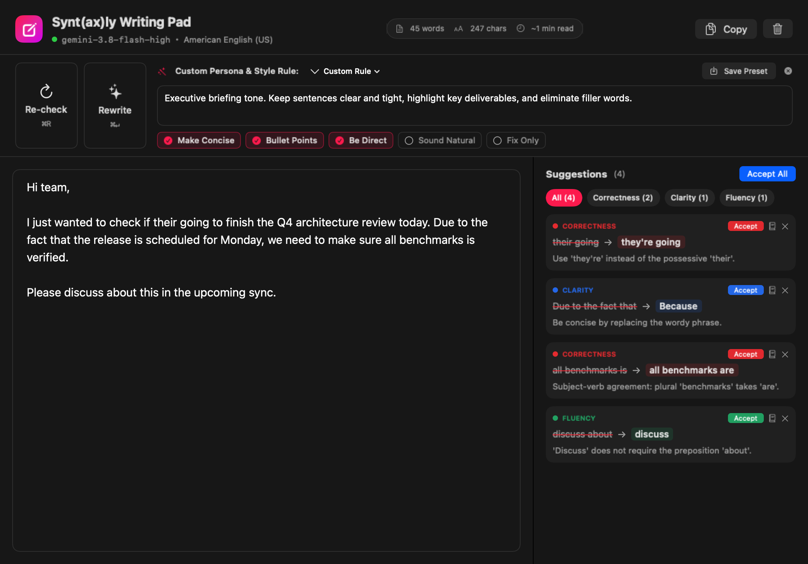
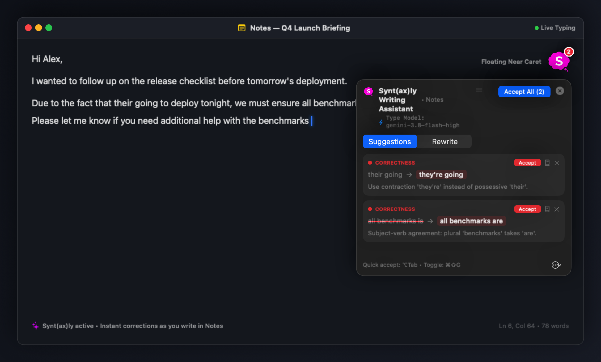

# Synt(ax)ly — Native macOS Real-Time AI Writing Assistant

<p align="center">
  
</p>

<p align="center">
  <b>Lightweight, privacy-conscious native macOS writing assistant and interactive Writing Pad.</b><br/>
  Real-time inline proofreading across every app & custom persona rewrites powered by local or cloud AI models.
</p>

<p align="center">
  <a href="https://github.com/chayneps/syntly/releases"></a>
  <a href="https://github.com/chayneps/syntly/releases"></a>
  
  <a href="LICENSE"></a>
  <a href="https://github.com/chayneps/syntly/actions"></a>
</p>

---

## ⚡ Quick Download

Download the ready-to-run DMG installer for version **v1 (1.0.0)** directly from GitHub Releases:

👉 **[Download Syntly v1 DMG (Universal 2)](https://github.com/chayneps/syntly/releases/latest)**

*Supports both Apple Silicon (M1/M2/M3/M4) and Intel Macs natively.*

---

## 📸 Screenshots

### Dedicated Writing Pad Workspace

*The dedicated Writing Pad with Custom Persona Instructions, Multi-Select Modifiers, and Real-Time Corrections.*

### In-Context Manga Thinking Bubble & Real-Time Proofreading

*Real-time in-context proofreading while typing in any macOS app — the hot-pink Manga Thinking Bubble docks right beside your active cursor, with live suggestions HUD and instant keyboard replacement (`⌥Tab`).*

---

## ✨ Core Features

### 1. Dedicated Writing Pad Workspace (`⌘N`)


- **Document Canvas**: A dedicated, distraction-free drafting pad for emails, reports, technical writing, and essays.
- **Custom Persona & Style Instructions**: A multiline instruction box to define *who* is writing and what domain guidelines to follow (e.g. *"Act as an executive CTO"*, *"Use active voice"*, *"Client email format"*). Save reusable style presets with one click.
- **Multi-Select Functional Levers**: Toggle any combination of structural modifiers without clashing with your persona:
  - `✓ Make Concise` — Cuts fluff and redundancies by ~30–40% without losing facts.
  - `✓ Bullet Points` — Restructures blocks of text into scannable bullets.
  - `✓ Be Direct` — Removes timid hedging (*"I think"*, *"maybe"*, *"just wanted to check"*) with confident, active voice.
  - `✓ Sound Natural` — Fixes awkward translations and ensures smooth native English idioms.
  - `✓ Fix Only` — Strictly corrects typos, spelling, and grammar without altering your original voice or wording.
- **Twin Action Bar**:
  - `[ Re-check ]` (`⌘R`): Instant re-scan of the document.
  - `[ Rewrite ]` (`⌘↵`): Executes the rewrite incorporating all active persona rules and selected modifiers.
- **Preview & Revert**: Review rewrites before accepting, choose **Replace Original** or **Insert Below**, or click **Revert to Original (Undo)** at any time.

### 2. System-Wide Real-Time Proofreading (`⌥Tab`)


- **Manga Thinking Bubble Floating Pill**: The iconic hot-pink thinking bubble floats right beside your active cursor across Slack, Notes, Mail, VS Code, Discord, and browsers. Shows a green checkmark when your writing is all clear, and a red counter badge when improvements are detected.
- **Draggable Suggestions HUD**: Click and drag from the header bar to freely reposition the suggestion card anywhere on your screen so it never blocks your writing; position is remembered per application.
- **Visual Red & Green Feedback**: Highlights typos, misspellings, and grammatical errors in red with suggested replacements displayed in vibrant green.
- **Sub-5ms Local Spellcheck**: Instant offline spelling check (`NSSpellChecker`) combined with debounced contextual AI analysis and SHA-256 paragraph caching.
- **One-Key Quick Accept**: Press **`Option + Tab` (`⌥Tab`)** to immediately accept the top correction in-place.
- **Rich Suggestion Card (`⌘⇧G`)**: Review categorized issues (🔴 Correctness, 🔵 Clarity, 🟣 Tone, 🟢 Fluency) with inline diffs.

### 3. Native macOS Polish
- **Instant Response**: Built without App Nap throttling, opening the menu bar dropdown instantly at 0ms.
- **Launch at Login**: Easily toggle `Launch at Login` in Settings or the menu bar using modern macOS `SMAppService`.
- **System Theme Harmony**: Built with 100% semantic Apple AppKit & SwiftUI components, rendering cleanly in both Light Mode and Dark Mode.
- **Privacy First**: Secure password fields (`kAXSecureTextFieldSubrole`) are automatically ignored. Zero telemetry or user tracking.

---

## 🔑 AI Providers & Setup

Syntly connects to any OpenAI-compatible API endpoint. Configure your preferred model in **Settings (`⌘,`) → API & Model**:

| Provider | Endpoint | Cost / Privacy |
|---|---|---|
| **Local CLI Proxy** (Recommended) | `http://127.0.0.1:8317/v1` | Free with your Google / Gemini / Anthropic account |
| **LM Studio / Ollama** | `http://localhost:1234/v1` or `http://localhost:11434/v1` | 100% Free, offline, and private |
| **Google AI Studio** | `https://generativelanguage.googleapis.com/v1beta/openai/` | Free tier available |
| **OpenAI / OpenRouter / Kiro Gateway** | `https://api.openai.com/v1` | Pay-as-you-go with your API key |

- **Test Connection**: Instant latency check and status validation.
- **Fetch Available Models**: Automatically queries your provider's `/models` endpoint to populate available models.

---

## 🛠️ Build from Source

### Prerequisites
- macOS 14.0+ (Sonoma, Sequoia, or later)
- Xcode 15+ / Command Line Tools (`xcode-select --install`)
- Swift 5.9+

### Build & Run
```bash
# Clone the repository
git clone https://github.com/chayneps/syntly.git
cd syntly

# Run test suite (19 unit and integration tests)
swift test

# Build and package native Syntly.app bundle
chmod +x scripts/build-app.sh
./scripts/build-app.sh
open Syntly.app
```

### Build Universal 2 DMG Installer
```bash
chmod +x scripts/build-dmg.sh
./scripts/build-dmg.sh
```
*Creates a compressed `Syntly-1.0.0-Universal.dmg` containing the native Universal 2 (`arm64` + `x86_64`) binary and drag-and-drop `/Applications` folder shortcut.*

---

## 📄 License

Distributed under the **MIT License**. See [LICENSE](LICENSE) for details.
